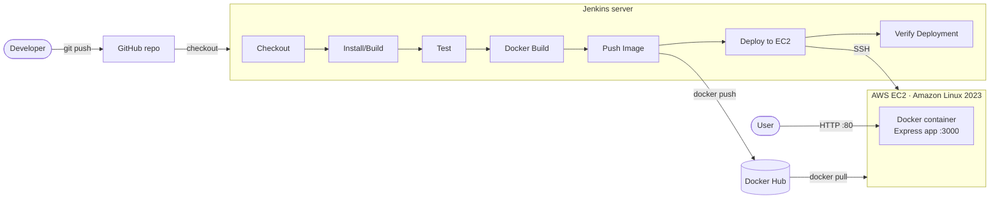
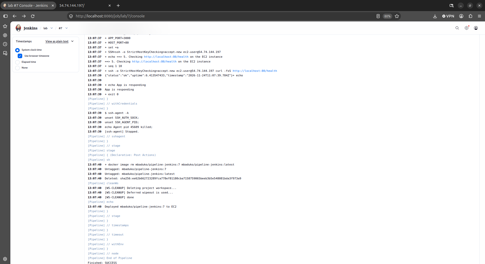
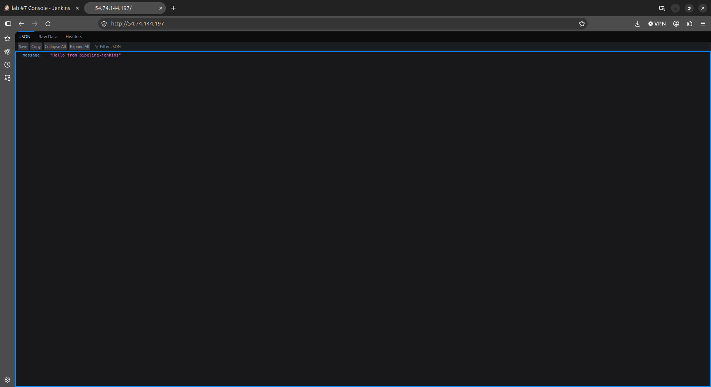
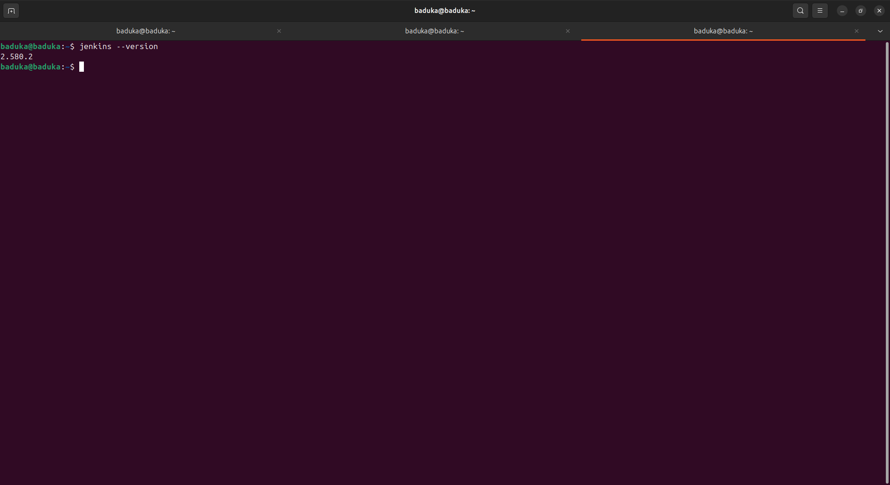
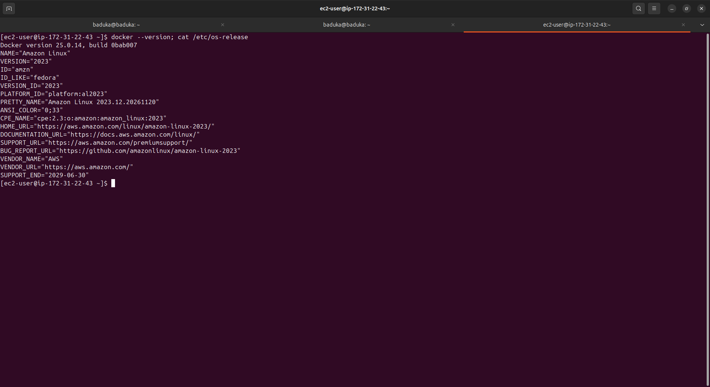

# pipeline-jenkins

A simple Node.js + TypeScript + Express app with a Jenkins CI/CD pipeline that builds, tests, packages it as a Docker image, pushes it to Docker Hub and deploys it to an AWS EC2 instance.

## Table of contents

- [Features](#features)
- [Architecture](#architecture)
- [Pipeline stages](#pipeline-stages)
- [Tech stack](#tech-stack)
- [Project structure](#project-structure)
- [Prerequisites](#prerequisites)
- [Getting started](#getting-started)
- [Available scripts](#available-scripts)
- [API](#api)
- [Jenkins setup](#jenkins-setup)
- [Screenshots](#screenshots)
- [Troubleshooting](#troubleshooting)
- [Contributing](#contributing)
- [License](#license)
- [Author](#author)

## Features

- REST API with a `/health` endpoint
- Unit tests with coverage
- Linting and formatting (ESLint, Prettier)
- Small, non-root multi-stage Docker image
- Automated build, test, push and deploy with Jenkins

## Architecture



## Pipeline stages

| Stage             | What it does                                                                    |
| ----------------- | ------------------------------------------------------------------------------- |
| Checkout          | Clone the repository                                                            |
| Install/Build     | `npm ci` and compile TypeScript                                                 |
| Test              | Run Jest tests with coverage and publish JUnit results                          |
| Docker Build      | Build the image tagged with the build number and `latest`                       |
| Push Image        | Push both tags to Docker Hub                                                    |
| Deploy to EC2     | SSH to the instance, pull the image, replace the old container, run the new one |
| Verify Deployment | Call `/health` on the instance until the app responds                           |

## Tech stack

Node.js · TypeScript · Express · Jest · Docker · Jenkins · Docker Hub · AWS EC2

## Project structure

```
src/
  app.ts            Express app
  server.ts         Entry point
  routes/health.ts  Health check route
tests/              Jest + Supertest tests
Dockerfile          Multi-stage production image
Jenkinsfile         CI/CD pipeline
```

## Prerequisites

- Node.js 20+ and npm
- Docker
- Jenkins (for the pipeline) and an AWS EC2 instance (for deployment)

## Getting started

```bash
git clone https://github.com/Mbaduko/pipeline-jenkins.git
cd pipeline-jenkins
npm ci
cp .env.example .env
npm run dev        # http://localhost:3000
```

### Environment variables

| Variable   | Default       | Description             |
| ---------- | ------------- | ----------------------- |
| `PORT`     | `3000`        | Port the app listens on |
| `NODE_ENV` | `development` | Runtime environment     |

### Run with Docker

```bash
docker build -t pipeline-jenkins .
docker run -p 3000:3000 pipeline-jenkins
```

## Available scripts

| Command                 | Description                   |
| ----------------------- | ----------------------------- |
| `npm run dev`           | Start in watch mode           |
| `npm run build`         | Compile TypeScript to `dist/` |
| `npm start`             | Run the compiled app          |
| `npm test`              | Run tests                     |
| `npm run test:coverage` | Run tests with coverage       |
| `npm run lint`          | Lint the code                 |
| `npm run format:check`  | Check formatting              |
| `npm run typecheck`     | Type-check the code           |

## API

| Method | Path      | Response                                              |
| ------ | --------- | ----------------------------------------------------- |
| GET    | `/`       | `{ "message": "Hello from pipeline-jenkins" }`        |
| GET    | `/health` | `{ "status": "ok", "uptime": ..., "timestamp": ... }` |

## Jenkins setup

**Plugins:** Pipeline, Git, JUnit, Credentials Binding, SSH Agent, Timestamper, Workspace Cleanup

**Credentials:**

| ID                         | Type                          | Purpose                    |
| -------------------------- | ----------------------------- | -------------------------- |
| `domo7-dockerhub`          | Username with password        | Docker Hub login           |
| `jenkins-agent-key`        | SSH Username with private key | SSH access to the EC2 host |
| `jenkins-pipeline-secrets` | Secret file                   | Deployment target (`.env`) |

The secret file uses `KEY=value` lines (no spaces around `=`):

```bash
EC2_HOST=<ec2-public-ip>
EC2_USER=ec2-user
CONTAINER_NAME=pipeline-jenkins
APP_PORT=3000
HOST_PORT=80
```

**EC2 instance:** Docker installed, the SSH user in the `docker` group, and the security group allowing SSH (22) from Jenkins and HTTP (80).

## Screenshots

**Successful pipeline run**



**App running on EC2**



**Jenkins version**



**Docker and OS on the EC2 instance**



## Troubleshooting

| Problem                             | Fix                                                            |
| ----------------------------------- | -------------------------------------------------------------- |
| `No such DSL method 'sshagent'`     | Install the **SSH Agent** plugin in Jenkins                    |
| `EC2_HOST: not found`               | Remove spaces around `=` in the secret file                    |
| `permission denied ... docker.sock` | Add the user (`jenkins` or the EC2 user) to the `docker` group |
| App not reachable in the browser    | Open port 80 in the EC2 security group                         |

## Contributing

1. Create a branch: `git checkout -b feature/my-change`
2. Commit using [Conventional Commits](https://www.conventionalcommits.org/) (`feat:`, `fix:`, `docs:` ...)
3. Make sure `npm run lint` and `npm test` pass
4. Open a pull request

## License

MIT

## Author

**Clement Nsengiyumva** – [@Mbaduko](https://github.com/Mbaduko)
