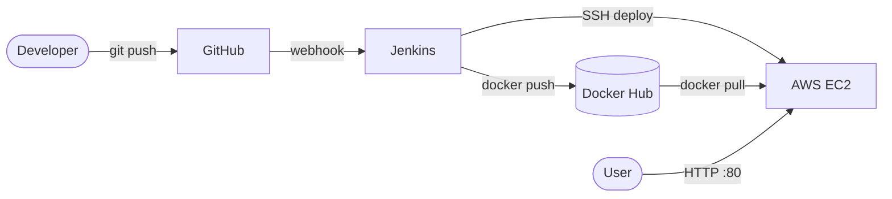

# pipeline-jenkins

A simple Node.js + TypeScript + Express app with a Jenkins CI/CD pipeline that tests it, builds a Docker image, pushes it to Docker Hub and deploys it to AWS EC2.

## Architecture



## Pipeline stages

1. **Checkout** – clone the repository
2. **Install/Build** – `npm ci` and compile TypeScript
3. **Test** – run Jest tests
4. **Docker Build** – build the image
5. **Push Image** – push it to Docker Hub
6. **Deploy to EC2** – pull the image and run the new container
7. **Verify Deployment** – check that `/health` responds

## Tech stack

Node.js · TypeScript · Express · Jest · Docker · Jenkins · AWS EC2

## Getting started

Requires Node.js 20+ and Docker.

```bash
git clone https://github.com/Mbaduko/pipeline-jenkins.git
cd pipeline-jenkins
npm ci
npm run dev        # http://localhost:3000
npm test
```

Run with Docker:

```bash
docker build -t pipeline-jenkins .
docker run -p 3000:3000 pipeline-jenkins
```

## API

| Method | Path      | Description      |
| ------ | --------- | ---------------- |
| GET    | `/`       | Greeting message |
| GET    | `/health` | Health check     |

## Jenkins setup

**Plugins:** Pipeline, Git, GitHub, Credentials Binding, SSH Agent, JUnit

**Credentials:**

| ID                         | Type                          | Purpose               |
| -------------------------- | ----------------------------- | --------------------- |
| `domo7-dockerhub`          | Username with password        | Docker Hub login      |
| `jenkins-agent-key`        | SSH Username with private key | SSH access to EC2     |
| `jenkins-pipeline-secrets` | Secret file                   | EC2 deployment target |

Secret file format (no spaces around `=`):

```bash
EC2_HOST=<ec2-public-ip>
EC2_USER=ec2-user
CONTAINER_NAME=pipeline-jenkins
APP_PORT=3000
HOST_PORT=80
```

## Screenshots

**Successful pipeline run**


**App running on EC2**


## License

MIT

## Author

**Clement Nsengiyumva** – [@Mbaduko](https://github.com/Mbaduko)
